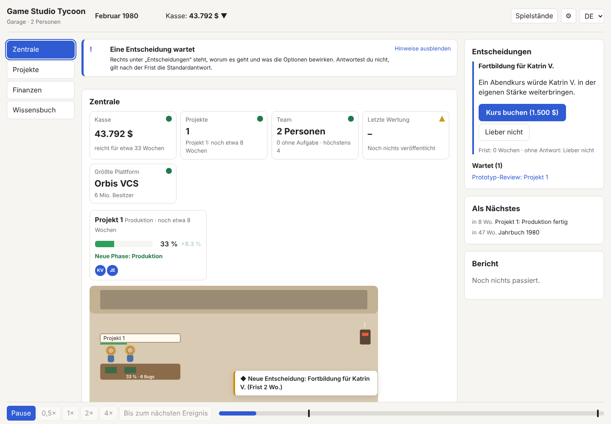
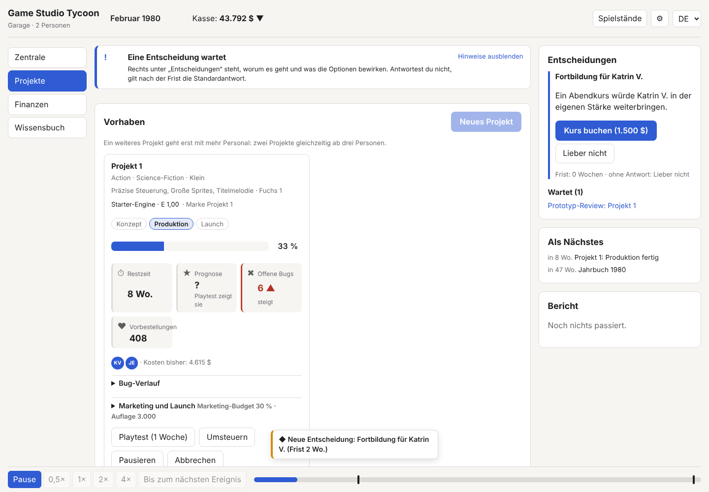

# Bitschmiede

Arbeitstitel bis 04.11.2026: „Game Studio Tycoon“ (Name gibt es schon als echte Spielreihe).

Wirtschaftssimulation: ein Spiele- und Engine-Studio von 1980 bis 2040 – Spiele und Engines entwickeln und lizenzieren, Marken aufbauen und handeln, Live-Betrieb, Konkurrenz mit Charakter.

> **English:** Business simulation game: run a game and engine studio from 1980 to 2040. Built in stages against a binding specification with rule IDs. The documents and the game texts are in German.

**Im Browser spielen:** https://seb-nsu.github.io/Bitschmiede/





Die Bilder zeigen einen frühen Stand mit dem Arbeitstitel.

## Meine Rolle und wichtigste Entscheidungen

Ich bin Projektleiter und Product Owner dieses Projekts. Design-Dokument, Spezifikation, Etappenplan und Abnahme stammen von mir; den Code haben KI-Agenten (Claude Code) nach meiner Spezifikation geschrieben.

| Entscheidung | Begründung | Nachzulesen in |
| --- | --- | --- |
| Verbindliche Spezifikation mit Regel-IDs | Jede Regel ist in Tests, Code und Commits wiederzufinden | [S00 Übersicht](docs/spec/S00-Uebersicht-und-Abgleich.md) |
| Eine Abgleichstabelle entscheidet Widersprüche (A01–A47) | Widersprüche zwischen den Spezifikationen werden einmal und sichtbar gelöst | [S00, Abgleich](docs/spec/S00-Uebersicht-und-Abgleich.md#abgleich-zwischen-den-spezifikationen) |
| Offene Fragen werden dokumentiert, nicht still entschieden | Fehlt etwas in der Spezifikation, gilt die kleinste plausible Annahme, im Code markiert | [Offene Fragen](docs/OFFENE-FRAGEN.md) |
| Bau in Etappen, nichts wird vorgebaut | Jede Etappe hat einen Umsetzungsplan und wird einzeln abgenommen | [Roadmap](docs/ROADMAP.md) |
| Balancing über automatische Simulationsläufe | Alle Balancing-Zahlen liegen in Daten, nicht im Code; Bots spielen ganze Läufe durch | [Balancing-Bericht](reports/simulate.md) |
| Keine echten Firmen-, Marken- oder Personennamen | Das Spiel ist frei von fremden Rechten | [Projektregeln](CLAUDE.md) |

- **Konzept:** [Design-Dokument](docs/design/Design-Dokument.md) · [Spezifikation S00–S14](docs/spec/)
- **Planung:** [Roadmap bis 2.0](docs/ROADMAP.md) · [Umsetzungsplan Etappe 1](docs/UMSETZUNGSPLAN-Etappe-1.md)
- **Abnahme:** [Spieltest 1.0](docs/SPIELTEST-1.0.md) · [externer Prüfbericht](docs/archiv/Pruefbericht-3-Fable.md)

## Inhalt

| Pfad | Was |
| --- | --- |
| `CLAUDE.md` | Projektregeln für Claude Code |
| `docs/STARTAUFTRAG-Etappe-0.md` | Erster Auftrag: Prototyp der Kernschleife (abgeschlossen) |
| `docs/design/Konzept-Prototyp-0b.md` | Prototyp-Schritt 0b: Entscheidungen, Personen, Aufträge (abgeschlossen) |
| `docs/UMSETZUNGSPLAN-Etappe-1.md` | Etappe 1 „Kern“: Teilschritte, Entscheidungen, Stand |
| `docs/UMSETZUNGSPLAN-Etappe-2.md` | Etappe 2 „Engines“: Teilschritte, Annahmen, Stand |
| `docs/UMSETZUNGSPLAN-Etappe-3.md` | Etappe 3 „KI und Lizenzen“: Teilschritte, Annahmen, Stand |
| `docs/design/Design-Dokument.md` | Vision, Systeme, Begründungen |
| `docs/spec/S00-Uebersicht-und-Abgleich.md` | Konventionen, Glossar, Abgleich A01–A47 |
| `docs/spec/S01` … `S14`, `Datenblatt-Startwerte.md` | Verbindliche Spezifikation |
| `docs/analyse/` | Recherche (reale Spieleentwicklung, Übernahmen) |
| `docs/archiv/` | Dritter Prüfbericht mit Umsetzungsstatus |
| `docs/OFFENE-FRAGEN.md` | Offene Punkte und Annahmen |
| `tools/bots.ts`, `tools/simulate.ts` | Bot-Strategien und Headless-Lauf 1980–2000 |
| `reports/simulate.md`, `reports/bench.md` | Letzter Balancing-Bericht und Leistungsmessung |

## Stand

Etappe 1 „Kern“ ist gebaut (Teilschritte 1.1–1.8): 1980 bis 2000 spielbar mit Plattformen, Verkäufen, Finanzen, Steuern, Krediten, Insolvenz, Büro, Ports und Addons, Ereigniskatalog, Jahrbuch, Speichern mit Autosave und Ironman. Offen ist die Abnahme mit Testspielern (1.9).

Etappe 2 „Engines“ ist gebaut (Teilschritte 2.1–2.9): eigene Engine mit acht Modulen, Stand der Technik und Engine-Faktor E, Engine-Team mit Forschung, Versionen und technischer Schuld, Fremdmodule zum Lizenzieren oder Kaufen, Engine-Bindung mit Feature-Freeze und Bestellung gesperrter Karten, Leistungsbudget je Plattform mit abgespeckten Versionen, Marken mit Franchise-Cockpit, Technik-Update, Upgrade und Remaster. Offen ist die Abnahme mit Testspielern; Balancing-Fragen stehen in `docs/OFFENE-FRAGEN.md`.

Etappe 3 „KI und Lizenzen“ ist gebaut (Teilschritte 3.1–3.12): Welt bis 2040, rund 20 bis 50 KI-Studios mit Archetypen, Nutzwert-Entscheidungen und „Warum?“, Engine-Lizenzmarkt in beide Richtungen mit Preis-Schocks, Rivalen mit Chef, Gedächtnis und Gegenzügen, Plattformbeziehungen und Devkit-Wellen, Teams und Schlüsselpersonen, Produzenten und Regeln, Büro mit Grundrissen und Ausstattung, Markenmarkt, Markt-Ansicht und Bühne mit Figuren. Offen ist die Abnahme mit Testspielern; Balancing-Fragen stehen in `docs/OFFENE-FRAGEN.md`.

Quelle der Dokumente: Claude Docs „Game Studio Tycoon – Design-Dokument“, Stand 29.10.2026. Änderungen am Design ab jetzt in diesem Repository pflegen.

## Befehle

```bash
npm install
npm run desktop      # Prototyp als Desktop-App (Electron): baut und öffnet das Fenster
npm run desktop:start  # Desktop-App ohne neuen Build starten
npm run dev          # Prototyp im Browser (Vite, für die Entwicklung)
npm run itch         # Browser-Build als ZIP für itch.io (release/bitschmiede-web.zip)
npm run check        # lint, typecheck, test, determinism, golden
npm run simulate     # Headless-Lauf 1980–2000 mit Bot-Strategien, Bericht in reports/simulate.md
npm run golden:update  # Golden-Runs bewusst neu freigeben (mit Begründung im Commit)
npm run bench        # Leistungsmessung, Bericht in reports/bench.md
npm run tables       # Nachschlagetabellen neu erzeugen (src/sim/tables)
```

## Lizenz

Code: [MIT](LICENSE). Grafik und Ton stammen aus freien Paketen unter CC0; jede Datei steht mit Quelle in [public/CREDITS.md](public/CREDITS.md).
